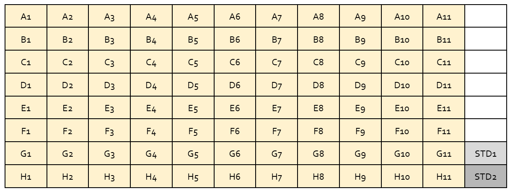
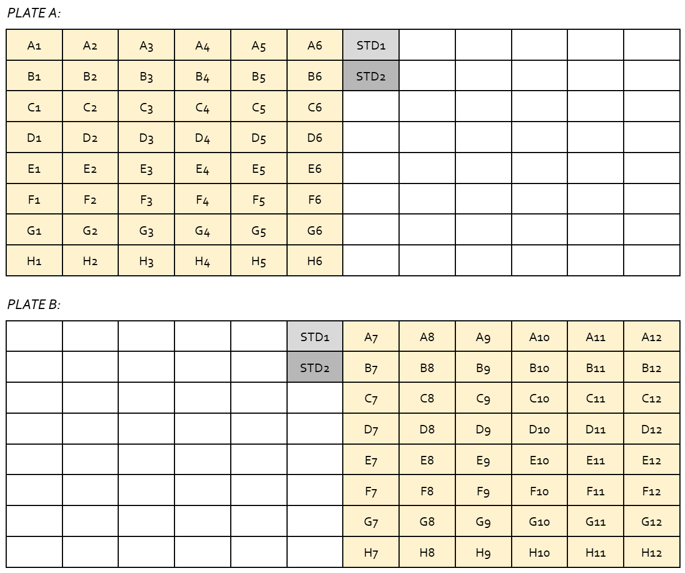

# Checking DNA concentration with the Gemini EM Plate Reader and Qubit™ dsDNA HS Chemistry

{: .note}
The Qubit reaction has an incubation time of 2 minutes, and its working solution is unstable when exposed to light. To minimize buffer degradation (and therefore maximize assay accuracy), set up the Plate Reader run before mixing any reagents.

   ### Device initialization and setup
1. Turn on the computer and Plate Reader device.
2. Open the SoftMax Pro 7.1 software.
3. Verify that the Plate Reader device is connected to the software. This is indicated by a Plate Reader icon with ✅ symbol in the upper left corner. If there is a 🚫 symbol, click the icon to search for the device. When “Gemini EM” is listed, click OK. There should now be a ✅ symbol.
4. Click Acquisition Settings and verify the following settings (or open the CCG-HA-Qubit template):
> - Read Mode: FL (Fluorescence)
> - Read Type: ENDPOINT
> - Wavelengths
>   - \# wavelength pairs,	1
>   - Excitation wavelength,	480 nm
>   - Emission wavelength,	530 nm
>   - Auto cutoff, ON
> - Plate Type: 96 Well Standard opaque
> - Read Area: Select All (or your sample layout, plus two additional wells for standards 1 and 2)
> - PMT & Optics
>   - PMT Gain, AUTO
>   - Flashes per read, 10
>   - Read from bottom, OFF
> - Shake, OFF
> - More Settings
>   - Calibrate, ON
>   - Carriage speed, NORMAL
>   - Read order, COLUMN

   ### Plate Reader template setup
5. Click Template Editor (or open the CCG-HA-Qubit template).
6. Set the desired concentration units as follows (default: mg/mL):
> a. Click **Standards > Standards,** then click **Edit.** 
> b. Ensure the **Sample Descriptor 1** checkbox is checked and select the desired units from the Sample Descriptor 1 drop-down menu. 
> {: .note}
> The CCG typically measures DNA concentration in in ng/µl. The Plate Reader offers µg/mL, which is 1:1 equivalent (1 µg = 1000 ng, 1 mL = 1000 µg). This can also be set manually by typing "ng/µL" directly into the Units field instead of using the drop-down menu.
> c. Select **OK.**
7. Define Standard 1 as follows:
> a. Click **Standards > Standards.** 
> b. Click to select the well that will contain Qubit Standard 1 (if running replicates of Standard 1, click and drag to select multiple wells). 
> c. Right-click your selection and select STANDARDS. 
> d. Under **Standards,** set **Sample** to indicate Standard 1 ("Standard 1," "STD 1," etc.). 
> e. Under **Standards,** set **Concentration** to 0 ng/µL (or 0 µg/mL; see note above). 
> f. Click ASSIGN. 
8. Repeat Step 7 for Standard 2, which has a concentration of 10 ng/µl (10 µg/mL).
9. Assign your sample well(s) as follows:
> a. Click **Unknowns > Unknowns.** 
> b. Click to select the well(s) that will contain your sample(s) (click and drag to select multiple wells). 
> c. Right-click your selection and select **Unknowns.** 
> d. Under **Standards,** set **Sample** to indicate Standard 1 ("Standard 1," "STD 1," etc.). 
> e. Under **Standards,** set **Concentration** to 0 ng/µL (or 0 µg/mL; see note above). 
> f. Click ASSIGN. 
10. Assign your sample name(s).
> - If your sample names are non-sequential, this must be done individually.
> > a. Click your desired sample well. 
> > b. Under **Assignment Options > Unknowns > Sample,** type your sample name and press **Assign.** 
> > c. Repeat steps 10.b and 10.c for each sample. 
> - If they end in a sequential numerical format (e.g., CCG-01, CCG-02, etc) then this can be done automatically as follows:
> > a. Click and drag to select the wells to receive sequential names. 
> > b. Under **Assignment Options > Unknowns,** select **Series.**  
> > c. Under **Start from,** select **Top to Bottom** (assuming you are working in 8-strip columns; if working in rows, select **Left to Right**). 
> > d. Set both **X-direction** and **Y-direction** to 1. 
> > e. Under **Sample Information > Starting sample name,** enter your sample prefix, followed by the starting sample number (e.g., CCG-01 will result in CCG-01, CCG-02, etc). 
> > f. Select **OK.** 
> {: .note}
> Do not assign samples to empty wells. To clear empty wells, right-click them and select Clear.
12. Double-check that your plate template setup accurately reflects your planned physical sample layout and press OK to exit the template editor.
13. Proceed to load your sample plate.

   ### Sample loading
13. Add 99 µL 1X dsDNA HS Qubit Reagent to each assigned well.
> {: .note}
> Unlike the Qubit device, sample and standard volumes must be equal for the Plate Reader software to automatically calculate sample concentrations.
14. Add 1 µL of sample DNA to each sample well.
15. Add 1µL of Qubit HS Standards #1 and #2 to their assigned wells.
16. Pipette to mix. 
> {: .caution}
> Do not vortex! The Plate Reader plates/lids do not seal tightly. Vortexing will likely cause splashing, which may cross-contaminate your samples.
17. Incubate 2 min @ RT, away from light (e.g., inside the Plate Reader drawer; see steps 18–20).
18. Press the Drawer button on the Plate Reader device to open the drawer.
19. Remove the plate lid and load the plate in the drawer, ensuring well A1 is in the upper left.
20. Press the Drawer button on the Plate Reader device to close the drawer.
21. Start the Plate Reader run by left-clicking READ (the green arrow) or pressing Ctrl + R.
> {: .note}
> If the “Read” button is disabled, select the plate setup template by left-clicking it.

   ### Data conversion and export
> {: .note}
> By default, the Plate Reader reports readings in relative fluorescence units (RFUs). These raw units can be mathematically converted to concentration values by calculating a standard curve and using the formula y = mx + b with y-intercept set to zero. However, the Plate Reader software can also do this for you using the Reduction feature.

> {: .note}
> The Plate Reader software runs on Windows 7, which is no longer supported (and thus cannot be connected to the Academy Internet network). File exports must be moved off the Plate Reader computer using a USB flash drive. If you don’t have a USB drive, the CCG has a loaner for checkout.

22. Left-click the PCR plate icon in the upper left corner of the screen.
23. Select Export > Export to XML XLS TXT.
24. Select the data to export (at minimum: your plates, samples, and standards).
25. Under Plate Export Options, select Reduced or Both.
> {: .note}
> If you select “Raw,” your data will be in relative fluorescence units (RFUs), which will need to be mathematically converted to concentration units as mentioned in the note above.
26. Under Output Format, select Columns or Plate and press OK.
> {: .note}
> The Columns and Plate formats are compatible with standard applications like Notepad, Microsoft Office, Google Drive, etc. XML is a markup language similar to HTML, and (while a valid output format) is not as easy to work with.
27. In the following Save As… menu, select an export destination and name your file as normal.
28. Select an output file format (XLS is compatible with Microsoft Office and Google Sheets) and press OK.
29. Transfer your data to a USB drive. On Windows 7, it is recommended to use the “Safely Eject Hardware” button on the taskbar before removing the flash drive to prevent data corruption.
30. Turn off the Plate Reader device and computer.

### Example plate templates

Click here to show/hide this section.

#### Standard setup ("mostly full")
This template is well-suited to plates that are “almost full.” Two standards occupy the bottom right corner (which are often the last to be filled), allowing the use of an 8-tip multi-channel. For a full plate, consider splitting as above (or quantifying the last two samples using a standard Qubit).

#### Full plate (split 96)
This template is well-suited to quantifying full plates (when all 96 wells are filled with samples). This allows for easy filling using an 8-tip multichannel pipette, and preserves the well/sample ID layout in the output spreadsheet.
Alternatively, you can split the samples vertically (top/bottom instead of left/right) and use a 12-tip multichannel pipette (if available).

